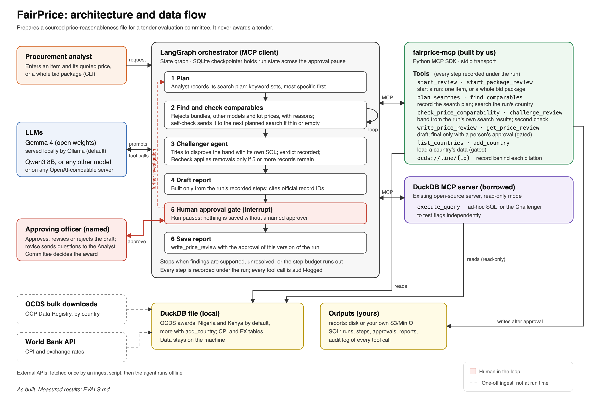

# Architecture

## Agent shape

A LangGraph state graph with six nodes. Every review is one **run** (see [Runs](#runs-one-review-across-many-tool-calls)): the tools record each step under the run's id, and the report is built only from those records. LangGraph's own state is checkpointed in SQLite (`data/runs.sqlite`), so a run paused at the approval gate can be resumed later with `--resume <run id>`.

| Node | What it does | Model? |
|---|---|---|
| **Analyst** | First records a search plan (`plan_searches`): the keyword sets it will try, most specific first. Then searches past awards, decides which records describe the same product, rejects bundles, lot prices and different specifications with a reason, and moves to the next planned search when a search is empty or thin. | Yes |
| **Self-check** (inside Analyst) | Sends the Analyst back if it did not plan, ran a search it never price-checked, found nothing, or stopped with a thin band or too few comparables; each time it names the next search in the Analyst's own plan. Then merges every record it kept across all checks into one final check. | No |
| **Challenger** | A second agent, with different tools, that tries to disprove the band using its own SQL. It names records to remove and gives a verdict: STANDS or DISPUTED, recorded in the run with `challenge_review`. | Yes |
| **Recheck** | Rebuilds the band without the records the Challenger removed. | No |
| **Draft** | `write_price_review(run_id)` without an approval builds the report (`report.py`) from the run's recorded steps only: first as data, stored as a draft row in the `reports` table, then as files in the chosen format (xlsx by default, csv or json) in the report store, named `DRAFT-…`. It cites past purchases by the publisher's own record ID (OCID and contract ID), not FairPrice's internal row numbers, which change when the data is re-downloaded. The model writes no numbers. | No |
| **Approval gate** | `interrupt()`: a named officer picks approve, revise (with questions, which restarts the Analyst) or reject from a menu. Revise and reject delete the draft. | Human |
| **Save** | Calls `write_price_review(run_id, approval)` with the approval the person granted at the gate; the tool rebuilds the report from the run, stamps it with that person's name and writes its final files. | No |

The model judges; code counts. Every number in a report comes from a tool output, and every past purchase is cited by its official record ID.

### Bid packages (`--package`)

`batch.py` reads a bid package (xlsx, csv or json) into one form and checks it against `bid_package.schema.json` and the rules the schema cannot express (unique BoQ lines and bidders, every bid line in the BoQ). A package that fails is refused with each problem's location; nothing is interpreted. Each row keeps its location (sheet and row, csv row, or JSON path) so findings can cite it. The whole package is one run, and each BoQ line is a line of that run. It runs the same graph once per distinct item, paused after Recheck, so it reuses the same evidence and the same evals. Each line's steps are recorded as they happen, so an interrupted package resumes (`--resume <run id>`) from the lines that finished. One failed line is reported and does not stop the batch.

Code then does three things:

- compares every bidder's unit price with that item's band;
- checks the bid files: arithmetic errors, missing lines, quantities that differ from the BoQ, and identical prices across bidders;
- builds one draft report for the package.

There is one approval gate for the whole package, and `revise` can redo chosen lines. On approval, `write_price_review` writes it as for a single item. The output never totals or ranks bidders. The Analyst is shown the median quoted price, not any one bid, so no single bidder steers which records it picks.

## MCP servers

| Server | Built or borrowed | Tools and resources | Used by |
|---|---|---|---|
| `fairprice-mcp` (`src/fairprice/server.py`) | Built, with the official MCP Python SDK | Runs: `start_review`, `start_package_review`. Steps: `plan_searches`, `find_comparables`, `check_price_comparability`, `challenge_review`. Reports: `write_price_review` (the action tool), `get_price_review`. Data: `list_countries`, `add_country`. Resource `ocds://line/{id}` | Analyst, Challenger (to record its verdict), Recheck, Save, other MCP clients |
| `mcp-server-motherduck==1.1.0` | Borrowed (MotherDuck, open source) | `execute_query`, `list_tables`, `list_columns`, `list_databases`; read-only by default for local files | Challenger |

**Why borrow the DuckDB server:** it is a maintained SQL server with a read-only mode, row limits and query timeouts already built in. Writing our own would add risk and no value. Keeping it separate also means the Challenger cannot simply rerun the Analyst's tools to confirm the Analyst's conclusion. It needs MCP SDK 2.x while our LangChain adapter needs 1.x, so it runs in its own environment through `uvx`. Once it is cached it starts with `--offline`, because a network blip during one eval run once failed the run when `uvx` checked PyPI.

### Runs: one review across many tool calls

`start_review` (one item and its quoted price) or `start_package_review` (a bid package as JSON) creates a run and returns its `run_id`. Every other step takes that id and is recorded in the `run_steps` table: the plan, each search (its keywords and the record ids it returned), each price check (the ids judged comparable, the ids rejected with reasons, and the tool's full result), the second check, and the run's cost. A caller passes only judgements, never facts:

- `check_price_comparability(run_id, candidate_ids, rejected)`: the quoted price, currency, year and country come from the run, not the caller. Ids the run's own searches never returned are refused, so every record in a band was found by a recorded search.
- `challenge_review(run_id, verdict, reason, objections)`: objections must name records in the line's band.
- `write_price_review(run_id, approval)`: no report body is passed in. The tool rebuilds the report from the run's steps, checks that every cited record exists, and saves a draft. A person's approval is for one **version** of the run (`<run id>@<last step>`): if anything is recorded after the draft, the approval is refused and a new draft is needed.

Because every step is stored, any run can be rebuilt after the fact (`server.review(run_id)`); the eval suite checks that a rebuilt run gives the same result as the live one. An app that is not FairPrice can do a whole review with these tools alone, and its report has the same guarantees as ours.

## Plan, act, check, recover, human

Where each part of agent behaviour lives, and the eval round that showed why it is needed ([EVALS.md](EVALS.md#how-we-got-here)).

| Behaviour | Where | What it does | Evidence |
|---|---|---|---|
| **Plan** | Analyst → `plan_searches` | Before searching, the Analyst records the keyword sets it will try, most specific first, and what it will reject. The plan is stored in the run and shown in the report for each line. | Round 8: whole-phrase searches found nothing and runs ended unresolved; the plan gives the recovery a next step that is the model's own. |
| **Act** | `find_comparables`, `check_price_comparability`, and the Challenger's `execute_query` | Search, judge comparability, build the band. Code adjusts prices for inflation and currency and computes the band; the model only judges which records are the same product. | Rounds 0 to 8. |
| **Check** | Self-check (code), Challenger (second model, different tools), Recheck (code) | The self-check refuses to finish an unchecked or thin result. The Challenger tries to disprove the band with its own SQL. Recheck applies its removals only if at least 5 records remain; otherwise they are shown as objections. | Round 1 (Challenger over-removed), round 2 (thin band from one search). |
| **Recover** | Self-check messages; step budgets; failed-line isolation | An empty, thin or insufficient search sends the Analyst to the next search in its plan (or a one-word search if the plan is used up). Step budgets end a stuck agent as `unresolved` instead of looping. One failed package line is reported and the rest continue. Every model call has a 10-minute timeout. | Round 0 (loops), round 4 (crashed run), round 6 (a recovery message that steered to the brand), round 8 (empty searches). |
| **Human** | Approval gate (`interrupt`), `fairprice --approve` | Nothing is written without a named person's approval of that exact version of the run. Revise sends questions back to the Analyst; reject deletes the draft. | Model-free checks in every round. |

**The search no longer depends on how the model groups words.** `find_comparables` matches every word of the keywords in any order, so `["hilux pickup"]`, `["pickup", "hilux"]` and `["Pickup Hilux"]` are the same search (round 8's failure).

**Human approval in the tools themselves.** `write_price_review(run_id, approval)` and `add_country(code, approval)` are the two tools that change something, and neither runs on an AI's say-so. Without an `approval`, each records a pending request in the `approvals` table and replies with `fairprice --approve <id>`, which a person runs in the terminal: it shows what is asked, takes the person's decision and name, and carries the action out. In FairPrice's own runs, choosing approve at the gate menu is that decision. An approval is single-use and tied to one action and one target (a version of a run, or a country code), and the approver's name comes from the approval, never from the caller. A rejected or replaced draft cancels its pending request. `get_price_review` reads the `reports` table and returns the report as JSON, whatever its file format and wherever its files are stored.

## Audit

Every MCP tool call on both servers passes through one interceptor, which prints it on screen and adds a row to the `audit_log` table with inputs, outputs, timing and run id. Human decisions (including the approver's name) and run starts and finishes are logged the same way, and the run's own steps are in `run_steps`. `uv run fairprice --audit <run id>` prints a run's log in time order.

The `runs` and `run_steps` tables hold every review and each step it recorded. The `reports` table holds one row per report: its name, run id, status (draft or approved), format, files, approver, dates, and the report itself as JSON (summary, prices and sources). The report files are the deliverable a committee opens; the table is the record that tools read.

These tables are written through SQLAlchemy (`db.py`), so `FAIRPRICE_SQL_URL` can point them at Postgres, MySQL or another database instead of the default SQLite file. We have tested it on SQLite only. LangGraph's run state (used by `--resume`) stays in SQLite. LangGraph has a Postgres checkpointer if that ever needs to move too.

## Report storage

`storage.py` keeps reports on the local disk by default, or in S3-compatible object storage (`FAIRPRICE_STORAGE=s3`) when several servers need to share them or reports need backing up with the rest of an organisation's files. Disk space is not the reason: a report is 10 to 20 KB. The intended deployment is MinIO on the organisation's own servers. Reports can contain bidders' prices from an evaluation in progress, which are commercially confidential. Keep them inside your own organisation and jurisdiction: on this computer (the default), or in object storage you run yourself, such as MinIO on your own servers. Use a cloud provider only if your procurement and data rules allow it. Both providers have the same four operations (save, load, delete, list), and report names cannot contain folders, so a name can never point outside the store. The draft, approval and retrieval cycle is tested on both providers in the eval suite, using a mocked S3 bucket (`moto`) for S3.
